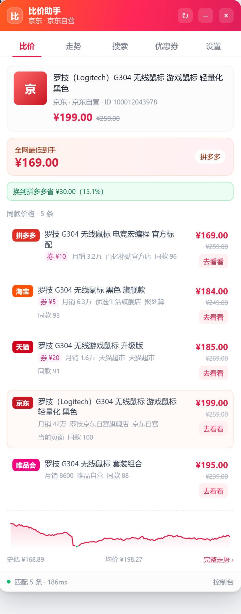
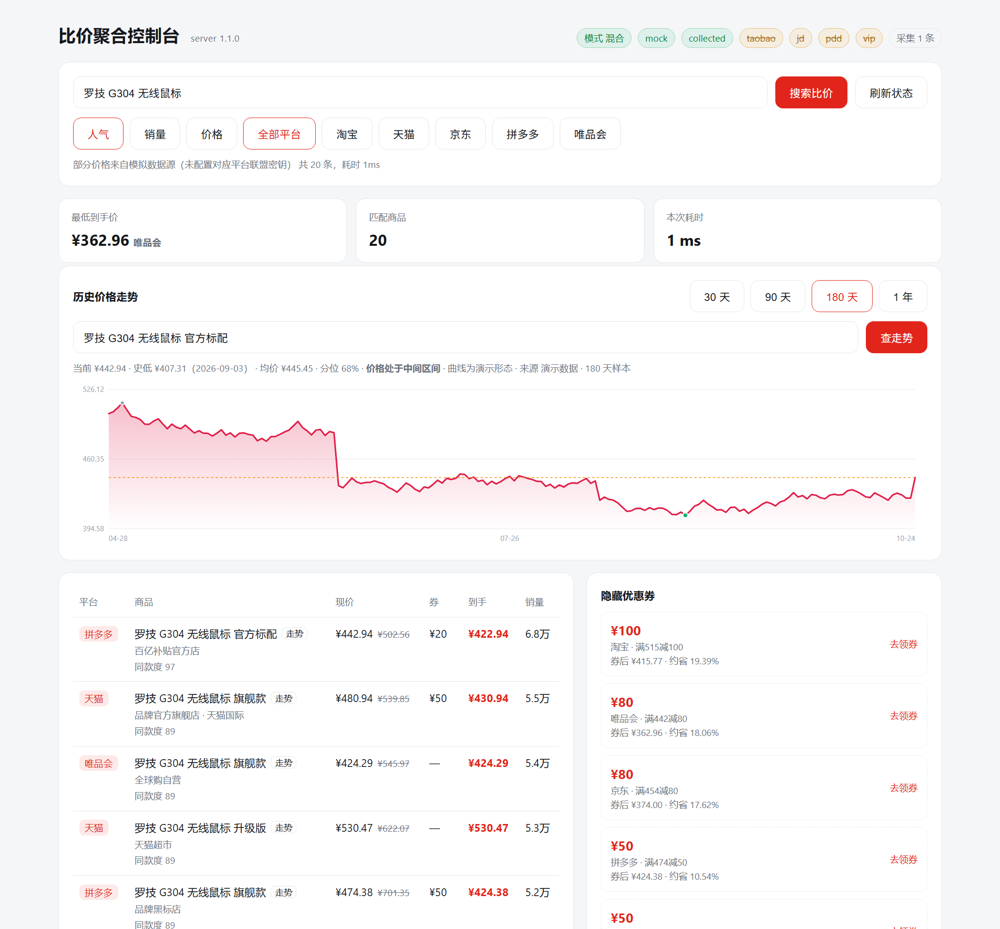
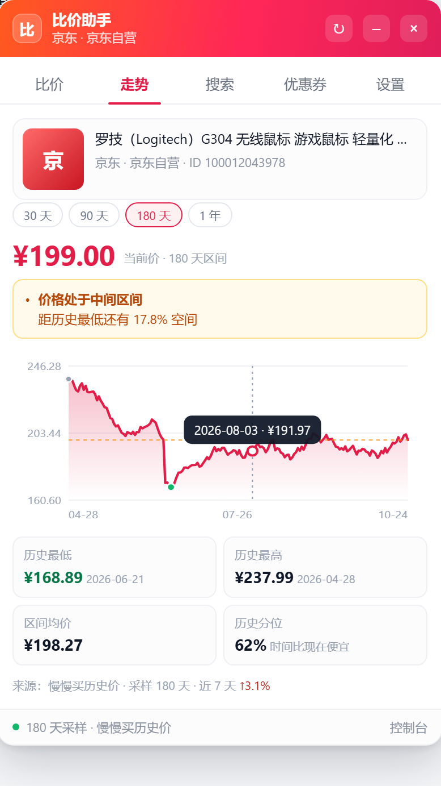

# 全网比价助手

商详页自动识别商品，跨淘宝、天猫、京东、拼多多、唯品会查同款价格；展示隐藏券、到手价、历史价格走势；支持按人气 / 销量 / 价格搜索。浏览器端是 Tampermonkey 脚本，数据端是可替换的本地聚合服务。



## 目录

```
比价/
├─ config.json                 运行配置（端口、模式、联盟密钥、历史源）
├─ config.example.json         配置模板
├─ server/
│  ├─ index.js                 HTTP 入口、路由、CORS、限流
│  ├─ dashboard.js             自带控制台（搜索 / 券 / 走势 / 采集记录）
│  ├─ config.js                配置合并、环境变量覆盖
│  ├─ store.js                 采集数据与历史价持久化（tmp + rename 原子写）
│  ├─ cache.js                 TTL 缓存
│  ├─ logger.js
│  ├─ providers/
│  │  ├─ index.js              数据源调度、超时、降级判定
│  │  ├─ taobao.js             淘宝客 taobao.tbk.dg.material.optional
│  │  ├─ jd.js                 京东联盟 jd.union.open.goods.query
│  │  ├─ pdd.js                多多进宝 pdd.ddk.goods.search（分转元）
│  │  ├─ vip.js                唯品会联盟网关（字段别名映射）
│  │  ├─ collected.js          页面采集缓存（零密钥也能拿到真实价）
│  │  ├─ history.js            历史价：上游适配 / 本地合并 / 演示铺底
│  │  └─ mock.js               确定性模拟数据（联调 / 演示）
│  ├─ service/
│  │  ├─ compare.js            同款匹配、最优方案、省多少
│  │  ├─ search.js             跨平台搜索、三种排序、分页
│  │  ├─ history.js            历史价编排：定位 key、统计、结论
│  │  ├─ normalize.js          结构归一、去重、同平台截断
│  │  └─ coupon.js             隐藏券汇总、去重、按面额/折扣率排序
│  └─ util/
│     ├─ http.js               请求、重定向、重试、gzip/br 解压
│     └─ sign.js               TOP / 京东 / 拼多多 MD5 签名
├─ userscript/
│  ├─ src/
│  │  ├─ core.js               纯函数（含历史统计与 SVG 绘图），两端共用
│  │  ├─ platform.js           站点规则表、详情页判定、排除规则
│  │  ├─ extract.js            四级信息抽取（meta → 页面 JSON → DOM → 正文）
│  │  ├─ store.js              GM 存储，退回 localStorage
│  │  ├─ api.js                GM_xmlhttpRequest / fetch
│  │  ├─ ui.js                 Shadow DOM 面板：比价 / 走势 / 搜索 / 券 / 设置
│  │  └─ main.js               入口、SPA 路由监听、自动上报
│  ├─ build.js                 按依赖顺序拼接 + vm 语法校验
│  └─ dist/bilian.user.js      构建产物（109 KB）
├─ test/
│  ├─ test-core.js             36 项：价格、标题归一、相似度、排序、ID、频道
│  ├─ test-extract.js          15 项：四级降级、频道页判定、异常页面
│  ├─ test-history.js          29 项：按天聚合、统计、结论、SVG、上游解析
│  ├─ test-server.js           21 项：接口、排序、分页、券、采集、历史价、CORS
│  ├─ test-userscript.js       19 项：jsdom 端到端（渲染 / 走势 / 搜索 / 券）
│  └─ run-all.js
└─ demo/
   ├─ preview.html             面板静态预览（不依赖后端，?tab=trend 看走势）
   ├─ panel.png                比价页面板截图
   ├─ panel-trend.png          走势页面板截图
   └─ dashboard.png            控制台截图
```

## 依赖

运行后端零第三方依赖，只要 Node.js ≥ 18。

测试需要 jsdom（仅 devDependency）：

```bash
npm install
```

## 运行

```bash
# 1. 配置（已经带了一份默认配置，改密钥即可）
copy config.example.json config.json     # Windows
cp config.example.json config.json       # macOS / Linux

# 2. 启动聚合服务
npm start
# [2026-10-24 02:00:00] INFO  比价聚合服务已启动
#   地址: http://127.0.0.1:8787
#   模式: hybrid | 数据源: mock, collected
#   数据目录: D:\AIGC\比价\data

# 3. 打开控制台
# http://127.0.0.1:8787
```

控制台带搜索、三种排序、券列表和采集记录：



构建并安装脚本：

```bash
npm run build
# 已生成 userscript/dist/bilian.user.js  109.3 KB
# 模块 7 个 · 站点规则 13 条 · 版本 1.1.2
```

Tampermonkey → 添加新脚本 → 粘贴 `userscript/dist/bilian.user.js` 全文 → 保存。脚本默认连 `http://127.0.0.1:8787`，面板「设置」里只能改成本机地址（`127.0.0.1` / `localhost`）和端口；商品标题、价格、链接只写入本机服务，脚本不会向其它服务器发送数据。后端未启动时，面板仍会提供各平台的同款搜索入口。

## 支持站点

| 站点 | 域名 | 频道标签 |
|---|---|---|
| 淘宝 | `*.taobao.com` | 商品详情 / 聚划算 |
| 天猫 | `*.tmall.com` | 商品详情 / 天猫超市 |
| 天猫国际 | `*.tmall.hk` | 天猫国际 |
| 京东 | `*.jd.com` | 商品详情 / 京东图书 / 京东电子书 / 京东工业品 |
| 京东国际 | `*.jd.hk` | 京东国际 |
| 京东大药房 | `*.yiyaojd.com`、`*.jingdonghealth.cn`、`*.jkcsjd.com` | 京东大药房 |
| 唯品会 | `*.vip.com`、`*.vipglobal.hk` | 唯品会 |
| 拼多多 | `*.pinduoduo.com`、`*.yangkeduo.com` | 商品详情 |

脚本在登录页、购物车、订单、支付、联盟后台等页面自动排除，不渲染面板。

## 数据源

| 数据源 | 接口 | 必需配置 | 说明 |
|---|---|---|---|
| 淘宝 / 天猫 | 淘宝客 `taobao.tbk.dg.material.optional` | `appKey` `appSecret` `adzoneId` | `user_type=1` 归天猫，其余归淘宝 |
| 京东 | 京东联盟 `jd.union.open.goods.query` | `appKey` `appSecret` | `result` 是 JSON 字符串，已二次解析 |
| 拼多多 | 多多进宝 `pdd.ddk.goods.search` | `clientId` `clientSecret` `pid` | 金额单位是分，统一除以 100 |
| 唯品会 | 联盟网关（`providers.vip.endpoint`） | `appKey` `appSecret` `endpoint` | 字段名走别名表，网关换实现不用改代码 |
| 页面采集 | `POST /api/collect` | 无 | 用户浏览商详页时脚本上报的真实价格 |
| 模拟数据 | 本地生成 | 无 | 同一关键词结果稳定，带 `mock: true` 标记 |

`mode` 三种取值：

- `mock`：只用模拟数据，联调界面和接口结构。
- `hybrid`（默认）：已配密钥的真实源全部启用；一个真实源都没配时退回模拟数据；`mock.fallback` 打开时用模拟数据补缺失平台。
- `live`：只用真实源，缺密钥的数据源在 `/api/health` 里标 `skipped`。

响应里 `mock` 字段为 `true` 表示这批价格含模拟数据，面板底部会显示橙点。

## 历史价格走势



面板第二个 tab 是走势：价格曲线、最低 / 最高点标记、当前价虚线、hover 看某天价格，区间可切 30 / 90 / 180 / 365 天。

数据按优先级合并，同一天只保留最低价：

| 来源 | 说明 |
|---|---|
| 上游历史源 | `config.history.upstreams`，拿到什么用什么，失败自动跳过 |
| 本地采样 | 每次打开商详页由脚本上报，`store.recordHistory` 按天存 |
| 演示序列 | 前两者加起来不足 3 天时铺底，响应 `mock: true`，面板打「演示曲线」角标 |

统计口径：

- **历史最低 / 最高**：区间内每日最低价的最小 / 最大值，附日期。
- **区间均价**：每日最低价的算术平均，不是采样点平均（避免一天刷新十次把权重拉偏）。
- **历史分位**：历史上有多少比例的采样低于现价。10% 表示现在比 90% 的时间都便宜。
- **近 7 天**：最近 7 天均价相对前 7 天的涨跌幅。
- **结论**：`best`（距史低 ≤1%）、`good`（分位 ≤25）、`normal`、`high`（分位 ≥80，建议等）、`sampling`（不足 3 天）。

### 接自己的历史源

`config.json` 里改 `history.upstreams`，`type: "generic"` 的 `endpoint` 支持占位符：

```json
{
  "history": {
    "enabled": true,
    "days": 180,
    "maxDays": 730,
    "mockFill": true,
    "upstreamTimeoutMs": 4500,
    "upstreams": [
      {
        "name": "myhis",
        "type": "generic",
        "enabled": true,
        "endpoint": "https://your-host/api/his?url={url}&days={days}",
        "headers": { "Authorization": "Bearer xxx" },
        "priceInCents": false
      }
    ]
  }
}
```

占位符：`{url}`（编码后）、`{rawUrl}`（原样）、`{platform}`、`{itemId}`、`{title}`、`{days}`。

返回格式任意一种都能解析：

```json
{ "data": { "max": 259, "min": 169, "his": [{ "price": "189.00", "updatetime": "2026-08-01" }] } }
{ "data": [{ "date": "2026-08-01", "price": "189.00" }] }
[{ "date": "2026-08-01", "price": "189.00" }]
```

`priceInCents: true` 时按分处理。价格单位不做启发式猜测，必须显式声明。

`mode: "live"` 下不生成演示数据，`mockFill` 自动失效。上游超时由 `upstreamTimeoutMs` 控制，默认 4.5 秒，超时立刻降级到本地采样。

内置的 `manmanbuy` 类型默认关闭：旧接口 `apapia-history.manmanbuy.com` 已 404，现行接口要扫码授权。接口恢复或你有可用地址时，把 `enabled` 改 `true` 并覆盖 `endpoint` 即可。

## 接口

```bash
GET  /api/health
GET  /api/search?keyword=罗技G304&sort=jiage&platform=all&page=1&limit=20
POST /api/compare       {"platform":"taobao","title":"...","price":199,"itemId":"..."}
POST /api/collect       {"platform":"jd","title":"...","price":199,"url":"..."}
GET  /api/history?url=https://item.jd.com/100012043978.html&price=199&days=180
GET  /api/history?key=jd:100012043978&days=90
GET  /api/coupons?keyword=...
GET  /api/stats
GET  /core.js            共享核心（控制台画图用同一份 code）
```

`/api/history` 的定位参数三选一：`key`（`platform:itemId`）、`url`（自动提 itemId）、`platform + itemId|title`。返回：

```json
{
  "ok": true,
  "key": "jd:100012043978",
  "days": 180,
  "points": [{ "t": 1777314874763, "p": 206.86, "mock": true }],
  "stats": {
    "count": 180,
    "current": 199,
    "min": { "price": 176.63, "ts": 1786127680218, "date": "2026-08-08" },
    "max": { "price": 206.86, "ts": 1777401280218, "date": "2026-04-29" },
    "avg": 190.11,
    "median": 191.93,
    "vsMin": 12.66,
    "vsAvg": 4.67,
    "position": 82,
    "trend": -1.01
  },
  "advice": { "code": "high", "label": "高于多数历史价位", "hint": "建议再等等，历史最低 ¥176.63" },
  "source": "local | mock | mixed | <上游名>",
  "mock": true,
  "realPoints": 1,
  "note": "",
  "data": { "max": 206.86, "min": 176.63, "his": [{ "price": 199, "updatetime": "2026-10-24" }] }
}
```

最后那个 `data` 字段是给按旧版比价接口格式取数的调用方留的兼容层，`his[].updatetime` 是 `YYYY-MM-DD`。

`sort` 取值：`renqi`（销量 75% + 评价 25%）、`xiaoliang`（销量降序）、`jiage`（到手价升序）。

`/api/compare` 返回：

```json
{
  "ok": true,
  "query": { "title": "罗技 G304 无线鼠标", "platform": "taobao", "price": 199 },
  "best": { "platform": "pdd", "finalPrice": 169, "coupon": 10 },
  "savings": { "amount": 30, "percent": 15.1, "to": "pdd" },
  "items": [
    { "platform": "pdd", "price": 179, "coupon": 10, "finalPrice": 169, "matchScore": 96 },
    { "platform": "taobao", "price": 199, "finalPrice": 199, "isCurrent": true }
  ],
  "coupons": [{ "amount": 20, "threshold": 205, "rate": 9.76 }],
  "history": [{ "t": 1761300000000, "p": 199 }],
  "historyStats": { "count": 1, "min": { "price": 199 }, "position": 0 },
  "historyAdvice": { "code": "sampling", "label": "采样中" },
  "stats": { "candidates": 34, "matched": 8, "elapsedMs": 186 }
}
```

`/api/compare` 只读本地采样，不请求上游历史源，所以不会被慢接口拖住；完整曲线走 `/api/history`。

## 同款匹配

1. 标题归一：全角转半角，抹掉「包邮 / 官方旗舰店 / 百亿补贴 / plus」等 40 多个促销词，标点转空格。
2. 分词：英文数字按词，中文按 bigram（比单字稳，比词典分词轻）。
3. 相似度：Jaccard 65% + 包含度 35%。
4. 校正：容量 / 重量 / 片数等规格冲突扣 18 分；品牌词相同加 8 分、不同扣 6 分。
5. 过滤：默认阈值 52；全不过线时放宽到 37，并在 `note` 里标注「同款匹配已放宽」。

复杂度 O(n·m)，n 为候选数（默认最多 60 条），m 为标题 token 数。单次比价 30 条候选耗时在 10ms 量级。

## 测试

```bash
npm test
```

预期输出：

```
PASS  test-core.js        36 项
PASS  test-extract.js     15 项
PASS  test-history.js     29 项
PASS  test-server.js      21 项
PASS  test-userscript.js  19 项
```

共 120 项。

`test-history.js` 覆盖：按本地时区聚天、同天取最低、分位计算、结论分支、SVG 坐标与空数据、三种上游格式解析、分单位换算、演示序列确定性与末点锚定、真实数据覆盖演示数据。

`test-userscript.js` 用 jsdom 造了一个京东商详页，注入 GM 垫片，加载**打包后的** `bilian.user.js`，验证：面板挂载、商品识别、自动比价、当前商品标记、迷你走势入口、走势页曲线与统计、hover 气泡、切区间重新取数、搜索、价格重排、券渲染、折叠恢复、设置页、采集上报、运行期无 JS 报错。

单独跑某一层：

```bash
npm run test:core
npm run test:extract
npm run test:history
npm run test:server
npm run test:userscript
```

## 手动验收

```bash
# 服务活着
curl "http://127.0.0.1:8787/api/health"
# {"ok":true,"version":"1.1.2","mode":"hybrid","providers":{"active":["mock","collected"],...}}

# 搜索 + 价格排序
curl "http://127.0.0.1:8787/api/search?keyword=%E7%BD%97%E6%8A%80G304&sort=jiage&limit=5"

# 比价
curl -X POST http://127.0.0.1:8787/api/compare -H "Content-Type: application/json" ^
  -d "{\"platform\":\"taobao\",\"title\":\"罗技 G304 无线鼠标\",\"price\":199}"

# 历史走势（180 天）
curl "http://127.0.0.1:8787/api/history?url=https%%3A%%2F%%2Fitem.jd.com%%2F100012043978.html&price=199&days=180"
# 期望：points 有几十到上百个点，stats.min/max/avg 非空，advice.code 有值
```

浏览器打开任意京东商详页，面板应出现在右上角：标题栏显示「京东 · 京东自营」，卡片显示识别到的标题与价格，下方是五平台到手价列表和迷你走势。点「走势」看完整曲线和区间切换，点「搜索」跨平台搜，点「优惠券」看券，点「设置」改后端地址。

## 已知边界

- 联盟接口需要相应平台的推广者资质和密钥；没密钥时只有模拟数据和用户自己浏览产生的采集数据。
- 页面选择器按 2026 年中的结构写，站点大改版可能失效。抽取有四层降级，最差还能从 `document.title` 和正文价格兜底。
- 历史价优先用真实数据：上游历史源 → 本地采样。两者都不足 3 天时才用演示序列铺底，响应 `mock: true`、面板打「演示曲线」角标，不会把算出来的曲线当真实成交价展示。
- 上游历史源没有默认可用的公共接口：慢慢买旧接口已 404，现行接口要扫码授权，其他比价站同样有反爬。接自己的接口填 `history.upstreams`，格式见上文。
- 反爬：真实接口由服务端调用，不经过浏览器；页面采集只在用户已登录的浏览器里读取当前页，不额外请求站点。
